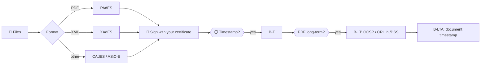

<div align="center">


# Doc Signer

**Sign PDFs, Office files and XML with your own certificate.**<br>
No Adobe, no cloud, no upload - a small native app for Windows and Linux.

[](https://github.com/dimchev/doc-signer/actions/workflows/ci.yml)
[](https://github.com/dimchev/doc-signer/releases)
[](#-license)


[**Download**](#-quick-start) · [Features](#-highlights) · [Formats](#-what-can-it-sign) · [Signature levels](#-signature-levels) · [Verify](#-verify-signatures) · [Build](#-build-from-source)

</div>

---

## ✨ Highlights

| | |
|---|---|
| ✍️ **One app, all formats** | PDF (PAdES), any file (CAdES `.p7s` / `.p7m`), XML (XAdES), ASiC-E containers |
| 🔑 **Your certificate** | Windows certificate store with smart cards and tokens (CNG and legacy CSP), or PKCS#12 / PEM files on Linux |
| ⏱️ **Trusted time and long-term proof** | RFC 3161 timestamps, PAdES B-T, B-LT and B-LTA with embedded OCSP / CRL data |
| 🎨 **Beautiful stamps** | Style gallery, round seals, your handwritten signature or logo, drag to place and resize |
| 🔍 **Verify anything** | Check signatures from any tool: integrity, signature value, timestamp, trust chain, changes after signing |
| 🔒 **Encrypted PDFs** | RC4 and AES-128 / AES-256 password-protected PDFs stay encrypted after signing |
| 🌍 **Your language** | English, Български, Deutsch, Español - picked from the OS language |
| 🛡️ **Private by design** | Files never leave your computer; only a hash goes to the timestamp server |

## 🚀 Quick start

1. Download the latest build from the [**Releases page**](https://github.com/dimchev/doc-signer/releases):
   - **Windows x64** - `doc-signer-windows-x64.zip`: unzip and run `doc-signer.exe`.
   - **Linux x64** - `doc-signer-linux-x64.tar.gz`: extract and run `./doc-signer`.
2. Drop files or a folder onto the window (or `Ctrl+O`, or pass paths on the command line).
3. Pick your certificate. Certificates for document signing are listed first and marked with ★.
4. Optionally place the stamp on the page, turn on the timestamp, and press **✍ Sign**.

> [!NOTE]
> The Windows build is not code-signed yet, so SmartScreen may warn on first start (*More info → Run anyway*).
> The Linux build needs glibc 2.35+, OpenSSL 3, GTK 3 and X11 (Ubuntu 22.04+, Debian 12+, Fedora 36+, current Arch):
> `sudo apt install libgtk-3-0 libx11-6 libssl3`. Page preview uses the bundled pdfium library.

## 📄 What can it sign?

| Input | Output | Standard | Choose under *Output* |
|---|---|---|---|
| **PDF** | Signed PDF with an optional visible stamp, as an incremental update (existing signatures stay valid) | PAdES (ETSI EN 319 142) | new file with a suffix (default ` - signed`) or overwrite |
| **Password-protected PDF** | Signed PDF with the same encryption and passwords | PAdES | 🔑 *Enter password…* on the card |
| **XML** (e-invoices, submissions) | Signature inside the XML (enveloped) or `file.xml.xades.xml` (detached) | XAdES (ETSI EN 319 132) | *XML files* |
| **Any file** (docx, xlsx, odt, images, zip, ...) | `file.ext.p7s` (separate) or `file.ext.p7m` (file embedded) | CAdES (ETSI EN 319 122) | *Other files* |
| **Several files at once** | One `.asice` ZIP with a manifest and one signature | ASiC-E (ETSI EN 319 162) | *Other files → .asice* |

Signed files are never overwritten by accident: `file.ext.p7s`, `file.ext (2).p7s`, ...



## 🛡️ Signature levels

| Level | What it adds | How to get it |
|---|---|---|
| **B-B** | Signature, certificate, signing-certificate reference | default |
| **B-T** | Trusted time from an RFC 3161 timestamp authority (only a hash is sent) | ☑ *Add trusted timestamp (TSA)* - default server `http://timestamp.digicert.com`, configurable |
| **B-LT** (PDF) | Revocation status (OCSP or CRL) and the full certificate chains of signer and TSA in the PDF's `/DSS` | ☑ *Long-term validation (PAdES B-LT)* |
| **B-LTA** (PDF) | Document timestamp over everything, so the proof survives expired certificates and closed CAs | ☑ *Archive timestamp (PAdES B-LTA)* |

- If the timestamp server cannot be reached, signing fails instead of silently producing a signature without the timestamp.
- If revocation data cannot be fetched (offline, LDAP-only addresses), the PDF stays B-T and the log shows a warning. SHA-1 signed OCSP responses, which current validators reject, are replaced by the CRL when one is available.

## 🎨 Stamps

- Click or drag on the page preview to place the stamp, **drag a corner to resize** (Shift keeps the proportions). Default: bottom right of the last page. Each document can use its own style (🎨 on the card).
- **Gallery:** Classic, Minimal, Badge, Corporate, Handwritten, Round seal - or *Edit…* your own:
  - shape: rectangle, rounded, ellipse, **round seal** with text along the arcs, or no border;
  - colours, single / double / dashed border, font;
  - an **image**: handwritten signature, logo or company seal from PNG / JPG / SVG / PDF, drawn in the app, or **taken from a signature in an already signed PDF** (e.g. Adobe, B-Trust, Evrotrust, pyHanko). White scan backgrounds are removed automatically;
  - which fields are shown and in which order: `{name}`, `{date}`, `{reason}`, `{location}`, `{issuer}`, `{contact}`. Cyrillic works.
- Styles live in `%APPDATA%\DocSigner\styles` (Linux: `~/.config/DocSigner/styles`), can be shared with *⋯ → Export / Import* (`.json`), and a *locked* style can only be duplicated. Design notes: [docs/design/stamp-appearance.md](docs/design/stamp-appearance.md).

## 🔍 Verify signatures

Press **🔍 Verify** on a card or next to a freshly signed file. Works for signed PDFs (all signatures and document timestamps, from any tool), `.p7s` (with the original next to it), `.p7m`, signed XML and ASiC containers (`.asice` / `.asics`, CAdES or XAdES).

| Check | ✔ / ⚠ / ✖ |
|---|---|
| The signed content is unchanged | ✖ if anything was modified |
| The signature value is valid (RSA / ECDSA) | ✖ if invalid |
| Trusted timestamp and the TSA's chain | ⚠ if missing, ✖ if invalid |
| Certificate chain against this computer's trusted roots, at the signing time | ⚠ untrusted / incomplete, ✖ expired or revoked |
| PDF: what was added after each signature | ✔ later signatures and validation data, ⚠ other changes |

<details>
<summary><b>🔐 Certificates</b> - where the app finds them</summary>

### Windows

Certificates come from the personal store (`CurrentUser\My`). The private key is used through Windows CNG, or the legacy CryptoAPI (CSP) for older smart-card middleware (RSA with a provider that supports SHA-256). For smart cards, Windows itself shows the PIN prompt.

### Linux

Certificates are read as files from the first folder that exists:

1. `$DOC_SIGNER_CERTS_DIR`
2. `$XDG_CONFIG_HOME/DocSigner/certs`
3. `~/.config/DocSigner/certs`

Supported files:

- **PKCS#12** (`.p12`, `.pfx`) - certificate + key (+ optional chain). The passphrase comes from `DOC_SIGNER_PASS` or a `.pass` file next to it (first line).
- **X.509 + private key** - `.crt`, `.cer`, `.der` or `.pem` plus the matching key next to it (e.g. `signer.crt` + `signer.key`, or `signer.pem` + `signer.key.pem`).

Passphrases:

- `DOC_SIGNER_PASS` applies to **every** key and PKCS#12 file in the folder.
- A `.pass` file (e.g. `signer.p12.pass`) stores the passphrase in plain text and must be readable only by you (`chmod 600 signer.p12.pass`); like ssh, the app ignores it otherwise.
- Files that cannot be parsed are skipped; ⟳ re-reads the list.

</details>

<details>
<summary><b>🧾 Formats in detail</b> - algorithms and file layout</summary>

- **PAdES:** `ETSI.CAdES.detached`, SHA-256, signing-certificate-v2, incremental update. B-LT completes missing chain certificates from the AIA addresses and stores OCSP responses / CRLs in `/DSS`; B-LTA adds an `ETSI.RFC3161` document timestamp.
- **Encrypted PDFs:** RC4 40/128-bit, AES-128, AES-256 (R5/R6). Owner-password-only files open directly. If the permissions forbid signing (no *fill in forms* / *annotate*), the owner password lifts it. Passwords stay in memory only.
- **CAdES:** content-type, message-digest, signing-certificate-v2, signing-time; CAdES-T with the timestamp option. Check with `openssl cms -verify -binary -inform DER -in file.docx.p7s -content file.docx -CAfile <root>` or the EU DSS validator.
- **XAdES:** exclusive XML canonicalization, RSA or ECDSA with SHA-256, SigningTime, SigningCertificateV2, DataObjectFormat; XAdES-B-T with a SignatureTimeStamp. Enveloped signatures leave the rest of the document byte-for-byte unchanged. *Verify* also accepts Canonical XML 1.0 / 1.1 and XAdES from other tools.
- **ASiC-E:** `mimetype` first, `META-INF/ASiCManifest.xml` with the SHA-256 of every file, one CAdES signature over it (`META-INF/signature001.p7s`). The container is named after the first file; PDFs in the same batch are signed as PAdES, not packed.

</details>

## 🛠️ Build from source

```sh
cargo build --release
```

The executable is `target/release/doc-signer` (`doc-signer.exe` on Windows).

<details>
<summary>Linux dependencies and page preview (pdfium)</summary>

Debian / Ubuntu package names (adjust for your distribution):

```sh
sudo apt install pkg-config libssl-dev libgtk-3-dev libx11-dev
```

Page rendering uses [pdfium](https://github.com/bblanchon/pdfium-binaries):

- **Windows:** extract `pdfium-win-x64.tgz` into `pdfium\` in the project root; `build.rs` copies `pdfium\bin\pdfium.dll` next to the executable.
- **Linux:** put `libpdfium.so` into `pdfium/bin/`; `build.rs` copies it next to the executable.

Without pdfium the app still works; pages are just shown blank.

</details>

## 🧪 Tests

```sh
cargo test
```

Every signature format is checked by an **independent validator** in CI (Linux and Windows):

| Format | Validator |
|---|---|
| PAdES B-B / B-T / B-LT / B-LTA, encrypted PDFs | [pyHanko](https://github.com/MatthiasValvekens/pyHanko) (incl. ETSI EN 319 102-1 LTA validation, offline) |
| CAdES `.p7s` / `.p7m`, ASiC-E | OpenSSL `cms -verify` and Python `zipfile` |
| XAdES | [signxml](https://github.com/XML-Security/signxml) |

<details>
<summary>End-to-end tests with a real certificate</summary>

The real-certificate tests are skipped unless these variables are set:

```sh
export DOC_SIGNER_TEST_PDF=/path/to/file.pdf
export DOC_SIGNER_THUMB="<SHA-1 fingerprint of the certificate, 40 hex chars>"
cargo test -- --include-ignored
```

| Variable | Effect |
|---|---|
| `DOC_SIGNER_TSA=<url>` | add an RFC 3161 timestamp (B-T) |
| `DOC_SIGNER_LTV=1` / `DOC_SIGNER_LTA=1` | add long-term validation data (B-LT) / plus an archive timestamp (B-LTA, needs `DOC_SIGNER_TSA`) |
| `DOC_SIGNER_PDF_PASSWORD=<pw>` | password of an encrypted input PDF |
| `DOC_SIGNER_TEST_XML=<file>` | XML file for the XAdES test (default: a generated sample) |

The tests write `<file>.pdf.signed.pdf`, `<file>.p7s`, `<file>.p7m`, `<file>.asice`, `<file>.signed.xml` and `<file>.xades.xml` and run the app's own verifier on them. Validate independently:

```sh
pip install pyhanko pyhanko-certvalidator signxml
python scripts/validate_signature.py file.pdf.signed.pdf signer-or-root.crt [--expect-timestamp | --expect-lt | --expect-lta] [--password <pw>]
python scripts/validate_xades.py file.xml.signed.xml root.crt
```

Helper scripts: `scripts/ltv_pki.sh` (test CA with CRL and OCSP responder on 127.0.0.1, used in CI), `scripts/make_encrypted_fixtures.py` (pikepdf) and `scripts/make_xades_fixtures.py` (signxml).

</details>

## ⚠️ Limitations

- Encrypted PDFs: only the standard password handler, not certificate (public-key) encryption.
- Revocation data is fetched over HTTP(S) only (no LDAP) and added for the new signature, not refreshed for older ones.
- *Verify* does not check revocation (OCSP / CRL) and does not support RSASSA-PSS or XPath / XSLT transforms in XML signatures.
- XML: UTF-8 only, no custom DTD entities; XAdES is signed as B-B / B-T (no XAdES-LT/LTA yet).
- RSA and ECDSA keys (ECDSA on Windows only as CNG keys; legacy CSP keys are RSA-only).
- ASiC-E containers are created and verified, not extended; up to 4 GB (no ZIP64).
- Not yet: signatures inside ODF (LibreOffice, Nextcloud Office) and OOXML (MS Office) documents - see [#39](https://github.com/dimchev/doc-signer/issues/39) and [#40](https://github.com/dimchev/doc-signer/issues/40).

## 🧩 Built with

[egui / eframe](https://github.com/emilk/egui) (GUI) · [lopdf](https://github.com/lopdf/lopdf) (PDF) · [pdfium](https://github.com/bblanchon/pdfium-binaries) via [pdfium-render](https://github.com/ajrcarey/pdfium-render) (preview, Apache-2.0, optional) · [quick-xml](https://github.com/tafia/quick-xml) (XML) · [tiny-skia](https://github.com/linebender/tiny-skia), [resvg](https://github.com/linebender/resvg), [ab_glyph](https://github.com/alexheretic/ab-glyph) and [image](https://github.com/image-rs/image) (stamps) · [ureq](https://github.com/algesten/ureq) (TSA, OCSP, CRL) · [RustCrypto sha1 / sha2](https://github.com/RustCrypto/hashes) · [flate2](https://github.com/rust-lang/flate2-rs) · [rfd](https://github.com/PolyMeilex/rfd) (file dialogs) · [windows-rs](https://github.com/microsoft/windows-rs) (CNG, certificate store) · [rust-openssl](https://github.com/rust-openssl/rust-openssl) (Linux)

## 📜 License

Licensed under either of [MIT](LICENSE-MIT) or [Apache License 2.0](LICENSE-APACHE), at your option.
